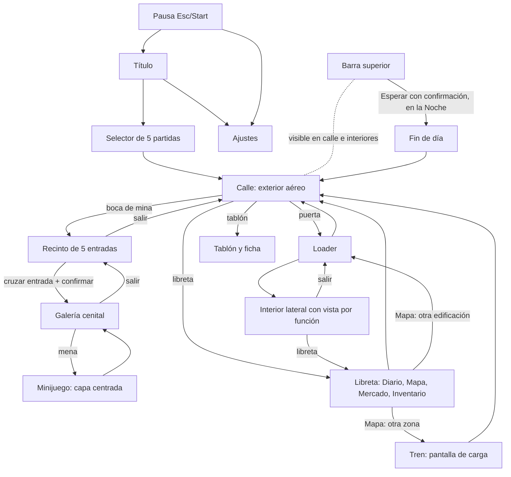

# 30 · Flujo de pantallas

Cómo se pasa de una pantalla a otra en Veta de Fortuna: qué nodos hay, qué los conecta, qué cuesta cada paso, dónde se puede abrir el mapa y qué se guarda en cada punto. Nace de la tarea F0-25 y de las 8 decisiones del autor del 2026-10-24. Es de **PC primero** (640×360, ratón, teclado y mando; Steam Deck); el táctil queda para la fase móvil ([10](10-tecnico-y-herramientas.md), ADR-0009). Se apoya en [26](26-zonas-y-edificios.md) (niveles), [01](01-core-loop.md) (bloques y guardado), [02](02-extraccion.md) (la mina), [29](29-calendario-y-temporadas.md) (barra, calendario y tablón) y [ADR-0011](adr/0011-exploracion-caminable-tren-y-minas.md).

**Estado.** ✅ Los nodos, las transiciones, la regla «consultar no es actuar» y el mando base son decisión del autor. Lo que se derivó de ellas va en la sección 8, confirmado por el autor.

---

## 1 · Principio rector ✅

**Consultar no es actuar** (decisión 1). La **libreta** es de consulta y se abre casi desde cualquier lugar; **comprar, vender, refinar y regatear solo ocurren dentro de un edificio** (decisión 2). La **pausa** (Esc o Start) es un menú aparte de la libreta. Caminar, loader y tren no gastan bloque ([01](01-core-loop.md)); la información visual nunca depende solo del color ni del hover (flechas, formas y cian frente a vinotinto; texto real en fuente pixel).

## 2 · Diagrama ✅

## 3 · Los 18 nodos ✅

Correspondencia con el diagrama: «Libreta» (LB) agrupa los nodos 3 (Mapa), 7 (vista de mercado en lectura), 14 (Diario) y 15 (tablón y ficha, que además se abre en la calle); «Vistas por función» (7) y el cartel de La Fosa cerrada (12) se dibujan dentro del interior (I) y del tren (TR). La pausa (PA) se abre con Esc o Start desde cualquier escena segura y desde los nodos donde el mapa está bloqueado; no se dibuja una flecha por origen para no saturar.

| # | Nodo | Tipo | Vista | Tarea |
|---|---|---|---|---|
| 1 | Título | Escena | Menú plano | ⏳ F2-41 (arte provisional ⏳ F3-29) |
| 2 | Selector de partida (5 ranuras) | Escena | Menú plano | ⏳ F2-41 |
| 3 | Mapa de Valdoria con niebla | Pestaña de la libreta | Imagen con zonas tocables | ⏳ F4-152, ⏳ F4-153 |
| 4 | Exterior (calle del asentamiento) | Escena | Aérea, caminable | ⏳ F3-49, ⏳ F4-217 |
| 5 | Loader | Transición | Fundido de menos de 1 s | ⏳ F3-50 |
| 6 | Interior lateral | Escena | Corte lateral plano | ⏳ F3-51 |
| 7 | Vistas por función (tienda, puesto, lonja, herrería, Bolsa) | Capa sobre el interior | Panel de mostrador | ⏳ F2-20, ⏳ F4-219, ⏳ F4-220 |
| 8 | Recinto de 5 entradas | Escena | Aérea cenital | ⏳ F3-52, ⏳ F4-225 |
| 9 | Galería | Escena | Aérea cenital, 2-3 pantallas | ⏳ F3-52, ⏳ F3-53, ⏳ F3-54 |
| 10 | Minijuegos | Capa centrada | Sobre galería o interior atenuados | ⏳ F2-14 |
| 11 | Tren | Pantalla de carga | Pantalla completa, ~6 s | ⏳ F4-248, ⏳ F4-154 |
| 12 | Cartel «La Fosa cerrada» | Aviso en mapa y estación | Panel corto | ⏳ F4-154 |
| 13 | Barra superior | Capa fija | Fecha, estación, clima, bloque, esquirlas y «Esperar» | ⏳ F3-57 |
| 14 | Diario (con Calendario y «En curso») | Pestaña de la libreta | Lista | ⏳ F3-48 |
| 15 | Tablón y ficha | Panel de objeto de la calle | Lista y ficha de 8 campos | ⏳ F3-58 |
| 16 | Fin de día | Escena de resumen | Panel | ⏳ F2-28 |
| 17 | Libreta V1 y V2 (Mercado de lectura, Inventario) | Pestañas | Panel | ⏳ F2-17, ⏳ F2-20; V2 ⏳ F4-119 |
| 18 | Ajustes | Pantalla | Menú plano | ⏳ F2-31 |

## 4 · Cada pantalla: objetivo, qué muestra primero, acciones y cómo se vuelve ✅

| Nodo | Objetivo | Muestra primero | Acciones | Atrás (B) |
|---|---|---|---|---|
| Título | Entrar al juego | Logo provisional y «Jugar» enfocado | Jugar, Ajustes, Salir | Salir pide confirmación |
| Selector | Elegir una de 5 partidas | Ranuras con zona, día y esquirlas; la última, enfocada | Cargar, nueva, borrar con confirmación | Título |
| Mapa | Ir a un lugar | Zona actual marcada con forma; zonas con niebla sin cifras | Elegir edificación o zona, ver ruta | Cierra la libreta |
| Exterior | Moverse y llegar a puertas | Personaje, puertas con indicador al acercarse | Caminar, A usar puerta u objeto | Sin retroceso: abre la pausa |
| Interior | Hablar y usar el mostrador | Mostrador o interactuable cercano | Caminar, A usar | Salida por la puerta (loader) |
| Vista por función | Comprar, vender, refinar, regatear | Mercancía, precio con flecha de tendencia y esquirlas | Operar, confirmar | Cierra la capa, queda el interior |
| Recinto | Elegir entrada | Cinco entradas sin revelar su calidad | Cruzar una, cambio único con aviso | Sale a la calle sin gasto |
| Galería | Escoger y picar menas | Menas visibles, carga del detector y bloque | Escanear, picar, cambiar de entrada | Vuelve al recinto |
| Minijuego | Resolver una mena | Instrucción corta y el control | Un botón o puntero con cursor | Abandonar cuenta como fallo de la mena |
| Tren | Cubrir el viaje | Ventanilla con el paisaje | Saltar (desde el 2.º viaje) | No se cancela |
| Libreta | Consultar sin gastar | Última pestaña usada | LB/RB cambia pestaña | Cierra |
| Tablón | Ver fichas de la zona | Fichas con certeza y fecha | Abrir ficha, aceptar propuesta | Vuelve a la calle |
| Fin de día | Cerrar el día | Ingresos, gastos, cuota y eventos | Continuar | Sin retroceso |
| Ajustes | Volumen, vibración, idioma | Valores actuales | Cambiar y aplicar | Vuelve a quien lo abrió |

## 5 · Transiciones ✅

| Origen | Destino | Disparador | Costo |
|---|---|---|---|
| Título | Selector | Jugar | 0 |
| Selector | Calle de la partida | Elegir ranura | 0 |
| Calle | Loader → interior | Usar una puerta | 0 |
| Interior | Loader → calle (puerta) | Salir | 0 |
| Calle | Recinto | Entrar a la boca de mina (loader) | 0 |
| Recinto | Galería | Cruzar la entrada y confirmar | 1 bloque de expedición (2 en zonas profundas) |
| Recinto | Calle | Salir sin entrar | 0 |
| Galería | Recinto | Salir; cambio único de entrada | 0; si no picaste ninguna mena, se devuelve el bloque |
| Galería | Minijuego | Picar una mena | 0 (desgaste y Aguante según [02](02-extraccion.md)) |
| Cualquier punto con mapa | Mapa | View (o botón de la libreta) | 0 |
| Mapa | Puerta de otra edificación de la misma zona | Elegir edificación | 0, con loader; apareces **fuera**, en la puerta |
| Mapa | Zona nueva | Elegir zona y confirmar billete | Billete 42 a 210 esquirlas; sin bloque |
| Calle | Tablón | Usar el tablón | 0 |
| Barra superior | Fin del bloque | Esperar y confirmar | Salta un bloque; el mercado se mueve igual |
| Fin del bloque Noche | Fin de día | Automático o Esperar | 0; recarga la batería del detector |
| Cualquier punto | Pausa | Esc o Start | 0 |
| Pausa | Ajustes o Título | Elegirlo | 0 |

## 6 · ¿Hay mapa? ✅

| Estado | Mapa | Nota |
|---|---|---|
| Calle | Sí | Desde cualquier punto |
| Interior y vista por función | Sí | Solo lectura; no se opera desde él |
| Recinto, galería | **No** | Gris con aviso «No puedes salir con la mina abierta» |
| Minijuego | **No** | Gris con aviso |
| Loader | **No** | Gris con aviso |
| Tren | **No** | Gris con aviso |
| Fin de día, título, selector | No | No aplica |

## 7 · Mercado, guardado, mando y mina ✅

**Mercado.** La libreta tiene la pestaña **Mercado en solo lectura** (precio, flecha de tendencia, noticias gratis). El mercado al contado se opera solo en edificios: tienda o puesto en el Acto I, lonja y herrería después, la Bolsa desde el Acto III.

**Guardado.** Autoguardado instantáneo en menús y entre bloques ([10](10-tecnico-y-herramientas.md)); punto de control al empezar cada acción ([01](01-core-loop.md), 64). La **posición** se guarda solo en calle, casa o andén.

| Nodo | Guarda | Al cerrar el juego aquí |
|---|---|---|
| Exterior, casa, andén | Posición | Vuelves al mismo punto |
| Interior | Estado y el último punto seguro | Vuelves a la puerta del edificio |
| Libreta, tablón, ajustes | Estado | Vuelves a la pantalla desde la que se abrió |
| Recinto y galería | No guarda posición | **Vuelves al inicio de la expedición**, fuera de la boca de mina, con el bloque sin gastar |
| Minijuego | No | Se reinicia la mena; el azar queda fijado |
| Loader y tren | No | Destino ya fijado: llegas al destino; el billete ya está pagado |

**Bloque de expedición.** Se gasta al cruzar la entrada de la galería, con confirmación; si sales sin picar ninguna mena, se devuelve. **Detector con mando:** LB/RB recorren las menas visibles y X escanea, igual que el clic del ratón ([02](02-extraccion.md)). Batería de 12/17/25/32 cargas; calidad de entrada ×0,78, ×1,0 y ×1,44 ([02](02-extraccion.md), [28](28-numeros-base-de-la-economia.md)).

**Mando base.** Stick izquierdo mover · A usar o aceptar · B atrás · Start pausa · View mapa · LB/RB pestañas (en la galería, menas) · stick derecho cursor (minijuegos de puntero). Teclado y ratón son los controles principales ([10](10-tecnico-y-herramientas.md)). Las zonas de clic miden, como mínimo, 24×24 px base (≈ 72 px en 1080p) y el texto no baja de 8 px base. ✅

## 8 · Propuestas del diseñador ✅ (confirmadas por el autor, 2026-10-24)

1. Tamaños: zona de clic mínima de 24×24 px base y texto mínimo de 8 px base, probados en la Steam Deck (×2).
2. Tras el fin de día, el personaje amanece en la casa base.
3. «Esperar» y la barra se desactivan con candado en recinto, galería, minijuego, loader y tren.

## 9 · Decisiones del autor ✅ (2026-10-24)

1. Menús = «consultar ≠ actuar»: libreta global (Diario con Calendario y «En curso», Mapa, Mercado en solo lectura, Inventario) y pausa aparte.
2. Mercado al contado solo en edificios.
3. Mapa bloqueado dentro de mina, minijuego, loader y tren; disponible en calle e interiores.
4. Minijuegos = capa centrada sobre la escena que los lanza.
5. Viaje por el mapa dentro de la zona: salto con loader; apareces fuera, en la puerta.
6. Detector con mando: LB/RB y X.
7. Bloque de expedición: se gasta al cruzar la entrada, con confirmación; se devuelve si no picas.
8. «Esperar» en la barra superior con confirmación; título, selector y pausa pasan a la tarea nueva F2-41.
9. Confirmadas las tres propuestas de la sección 8 (tamaños mínimos, amanecer en la casa base, candado en la barra).
10. Cerrar el juego en un interior te deja en la puerta del edificio; en un loader o en el tren, en el destino con el billete ya pagado.
11. «Menús V1/V2» = libreta de V1 (Diario, Mapa, Mercado en lectura, Inventario) más pestañas de V2 como estilo de vida (⏳ F4-119).

## 10 · Pendiente aplazado ✅

- ⏳ F4-154 Cartel y avisos del tren con La Fosa cerrada.
- ⏳ F4-236 Glifos del mando y foco por pantalla.
- ⏳ F4-152 Atajos de teclado del mapa; ⏳ F2-20 los de la libreta y la barra.

## 11 · Tareas que dependen

| Tarea | Qué toma |
|---|---|
| ⏳ F2-41 | Título, selector de 5 partidas y pausa |
| ⏳ F2-31 | Ajustes, que se abren desde título y pausa (depende de F2-41) |
| ⏳ F3-29 | Pantalla de título provisional (depende de F2-41) |
| ⏳ F2-20 | Pantallas placeholder: tienda y libreta con Mercado de lectura |
| ⏳ F3-46 · ⏳ F4-167 | Mapa y salto a la puerta de la edificación |
| ⏳ F3-52 · ⏳ F3-53 | Recinto, bloque de expedición y detector con mando |
| ⏳ F3-57 · ⏳ F3-58 · ⏳ F3-48 | Barra con «Esperar», tablón y diario |
| ⏳ F4-154 · ⏳ F4-236 | Cartel del tren y glifos |
